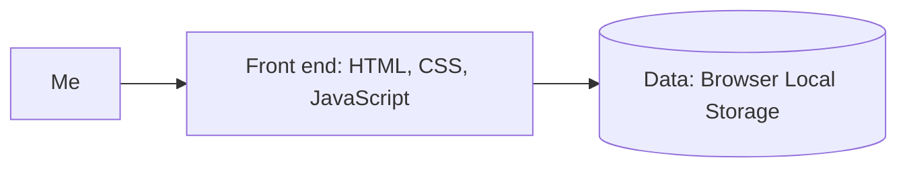

# Room to Finish

Helping people decide what to focus on and make time for what matters.

**Author:** Isimar Lara · **Course:** CMP 464/343 Product 1 · **Last updated:** 10/29/26

---

## 1. About Me (the User)

I'm a student attending classes two days a week. I’m currently looking for a part-time job to earn money. I’d like to work on weekdays when I don't have classes and keep weekends available for homework, while also making time for interests like crocheting.

My current responsibilities usually feel manageable, but overlapping assignments and unexpected difficulty sometimes leads me to rush, stay up late, or give up personal time. Before adding a job, I want to better understand how much I can realistically take on and how to divide my time between different responsibilities.

1. Last week: My homework was due the next day at 1:59 pm, just before my 2pm class. Because I had another class beforehand, I needed to finish the night before. The material took longer to understand than expected: at my usual fish time of 7pm, I still had three questions left. I worked until 10pm, felt rushed, and thought the quality of my work reflected that. This took up the time I had planned to spend crocheting before bed, leaving me disappointed that I missed my chance to unwind.
2. Past semesters - A recurring pattern: When I took more classes, I had multiple homework assignments each week and found it harder to decide what to work on first. I remember trying both harder assignments first and easier assignments first, but sometimes the difficulty turned out differently than I expected. I don’t remember a specific instance in enough detail yet.
3. Midterms - During my 4 years of college there is always midterm season and with multiple classes comes multiple midterms sometimes on the same day sometimes within the same week. I dont always know what my main focus should be when studying and I have to divide my time so I can study sometimes when ending my day of studying i feel like i should have studied for one exam more than the other sometimes im studying till the last minute because my time was divided enough so I feel fully ready.

- ⏱️ Time:Last week, homework took three hours longer than my usual finish time.
- 💸 Money:No direct financial cost identified. I’m looking for work, but I’m uncertain how it will fit around school.
- 🔋 Energy:Unexpected work can keep me working late and feeling rushed.
- 🙂 Joy:I lost the time I planned to spend crocheting and unwinding, which leaves me disappointed.

When homework overlapped with a concert, I completed some beforehand and the rest the next day. The assignment was manageable, and adjusting my schedule let me finish while keeping plans that mattered to me.

---

## 2. Problem Statement

**Gut check:**

I need to make realistic decisions about how to divide my time because unexpected workloads can leave me rushing to finish and giving up time I planned for myself.

**Five Whys:**
1. Why do I rush to finish assignments?
Sometimes they take longer than the time I’ve set aside.
2. Why do I set aside less time than I need?
I judge the workload based on how difficult it looks or how long previous assignments took.
3. Why isn’t that reliable?
Even familiar weekly homework can involve material that takes longer to understand.
4. Why is it difficult to adjust when that happens?
By the time I realize how much work remains, my other commitments limit the time available before the deadline.
5. sWhy does that create a problem for me?
My plans don’t leave enough room for unexpected difficulty, so finishing means sacrificing rest or personal plans.

**Problem statement:**

When assignments overlap or take longer than expected, I struggle to decide what to start first and how much time to set aside, which costs me time to relax and leaves me rushing to submit work that doesn’t reflect my best effort. Last week, I finished at 10 p.m. instead of my usual 7 p.m. and lost my planned time for crocheting. This happens because I often don’t understand the workload until I begin, and my other commitments limit the time I have to adjust. Right now I check Brightspace, write down classes and due dates, and order assignments by expected difficulty, but those estimates can be wrong and due dates alone don’t tell me how much usable time I have.

**I'll know this is solved when:** 

I can handle overlapping responsibilities and unexpected difficulties with enough time to finish work I’m satisfied with, while usually keeping my planned time for rest and hobbies.

---

## 3. Existing Solutions

| What I use or tried | What it does well | Why it falls short *for me* |
|---|---|---|
| Brightspace | Shows my assignments and due dates. | Knowing the deadline doesn’t tell me how long an assignment will take or how it fits around my other commitments. |
| Paper list | Makes it easy to write down classes and deadlines and cross off completed work. | It starts to feel scattered as assignments change. I still have to figure out priorities and time myself. |
| Notes app | Gives me a simple place to write down tasks. | Creating checklists and organizing sections felt time-consuming. Everything became one long list, and I disliked how it looked. |
| Notion | I can organize what I need. | It has more options than I need, which can feel overwhelming. I dislike the interface, making it less appealing to use. |
| Doing the hardest or easiest assignment first | Helps me choose where to start. | My first impression of difficulty can be wrong, leaving me with more work than expected in the remaining time. |

I can write down what needs doing, but I still struggle to decide what realistically fits into my available time and adjust when the workload changes without making planning itself overwhelming.

---

## 4. Features & Benefits

Currently, Room to Finish helps me keep track of tasks and their details. Next, I want to add daily planning so I can see what fits into the time I have available.

| Feature (what it does) | Benefit (how my life gets better) | MVP or Later? |
|---|---|---|
| Add tasks with optional due dates and Low, Medium, High, or no priority. | I can keep responsibilities and important details organized in one place. | MVP — built |
| Choose an estimated time of 30 minutes, 1 hour, 2 hours, or “Not sure yet.” | I can record expected effort without needing an exact answer. | MVP — built |
| Check or uncheck tasks, delete tasks, and save details and completion in the browser. | I can track progress without recreating my list after refreshing. | MVP — built |

**MVP (2–3 features):** - 
- Add tasks with estimates, optional priorities, and optional due dates.
- Mark tasks complete or incomplete and delete tasks.
- Save task details and completion in the browser.

**Later:**
- Edit existing tasks and revise estimates.
- Allow custom time estimates beyond the current dropdown choices.
- Add categories and filter or sort tasks.
- Color displayed priorities: High red, Medium yellow/amber, and Low green.
- Enter available hours and compare them with a daily plan.
- Allocate part of a task to today and continue it across days.
- Show tasks without estimates separately from the planned-time total.
- Give a friendly notice when planned work exceeds available hours.
- Compare estimated and actual time spent.
- Calendar integration.

**Not doing:**
- Complex page customization like Notion.
- Automatically deciding every priority or promising accurate time estimates.
- Accounts or syncing between devices in this version.
---

## 5. Tech Stack

### Front end
- **Surface:** Web
- **Tools:** HTML, CSS and JavaScript
- **Why:** I can use skills I already have to create a simple layout for viewing tasks and planning my time. A responsive layout will let me open it on a computer or phone.

### Back end
| Piece | Choice | Why |
|---|---|---|
| Server / API | No server for the MVP |The first version can manage tasks. |
| Data storage |Browser Local Storage | Saves my task details and completion status.|
| Outside services (optional) | Google Fonts for the Merriweather heading font | Provides the heading font; task data stays in the browser and is not sent to Google Fonts. |
| Hosting / deploy | Code hosted on GitHub; live deployment not set up yet | GitHub stores my source code and commit history. A public website link still needs to be set up. |

### Architecture sketch

---

## 6. Open Questions

- Will creating and organizing tasks feel simple enough that I’ll keep using it?
- How should I plan tasks when I’m unsure how long they’ll take?
- How much extra time should I leave for unexpected difficulty?
- Will the daily plan help me finish responsibilities while keeping time for hobbies and rest?

---

## 7. Demo

This demo shows adding tasks, checking and unchecking them, deleting them, and refreshing to confirm changes stay saved.

